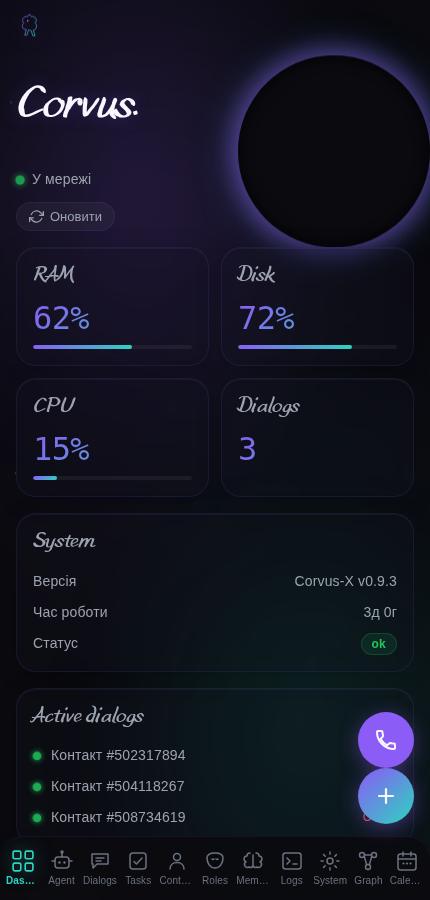
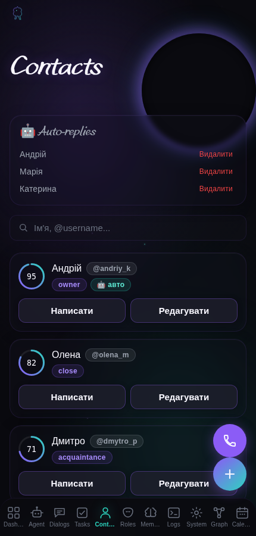
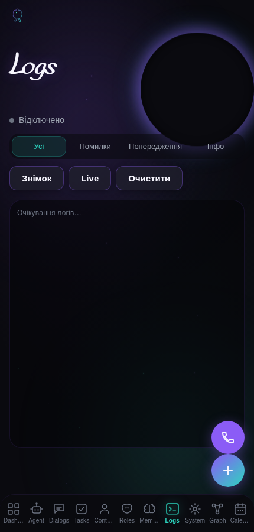
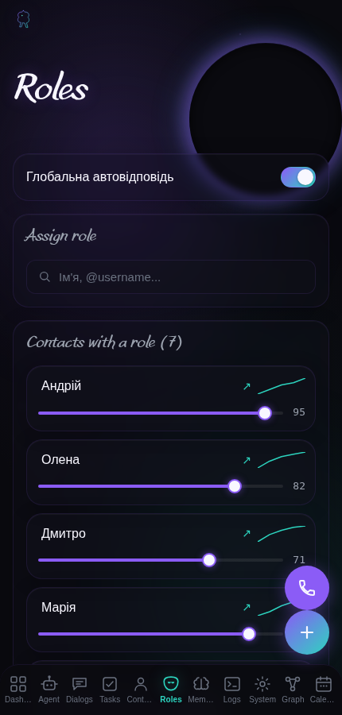
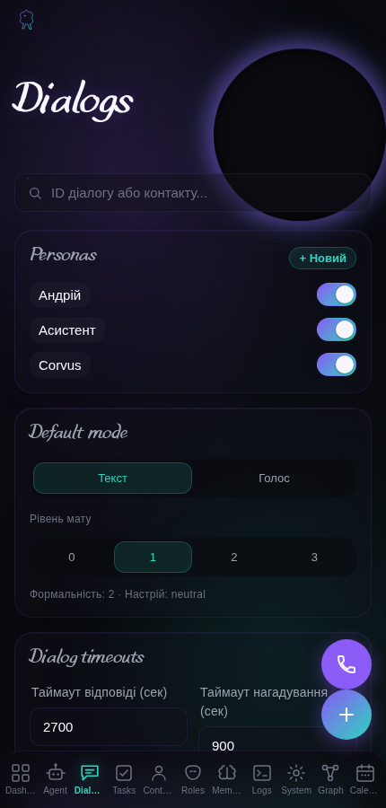
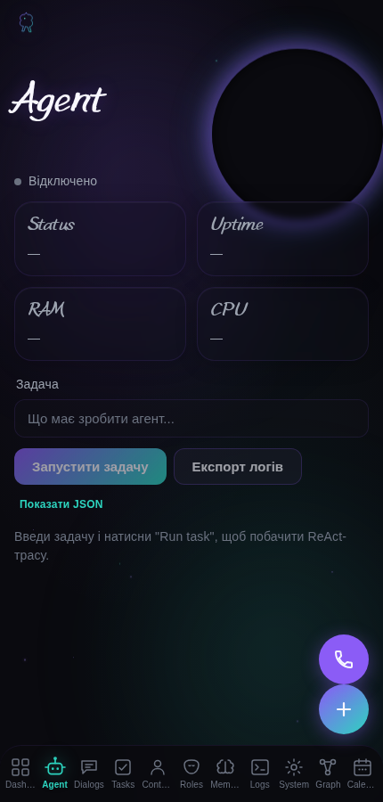
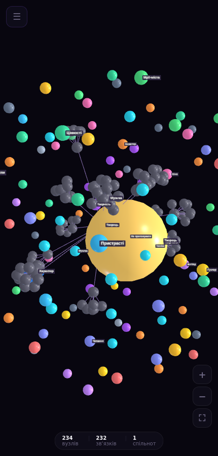

# 🦅 Corvus

### Персональний ШІ-асистент, який спілкується у Telegram, пам'ятає, з ким говорить, і працює на вашому сервері — дешевому VPS, домашньому ПК або навіть Android-смартфоні.

[English version](README.md) · [Можливості](#-можливості) · [Архітектура](#-архітектура) · [Статус](#-статус) · [Контакт](#-контакт)

---

## Що це таке?

**Corvus** — це персональний асистент для одного користувача, який працює на одному VPS і
спілкується з людьми через Telegram. Це не обгортка над чужим чат-ботом, а **модульний моноліт з
гексагональною архітектурою**, де бізнес-логіка не знає, у якому месенджері вона говорить.

Він може працювати **у двох режимах**: як звичайний бот, або заходячи у **ваш власний обліковий
запис Telegram**, щоб писати від вашого імені. Асистент веде довготривалу пам'ять про кожного
контакту (факти, епізоди, відносини, граф знань), навчається вашому стилю письма, працює з
голосовими повідомленнями та живими голосовими дзвінками, керує задачами й нагадуваннями.

> ⚠️ **Цей репозиторій — вітрина, а не вихідний код.** Код приватний і пропріетарний. Тут лише
> документація та скріншоти. Дивіться [LICENSE](LICENSE).

---

## 📱 Завантажити демо (Android)

[**⬇️ Corvus Demo 1.1 — APK, 13,3 МБ**](https://github.com/Arti2210/corvus-showcase/releases/download/v1.1-demo/corvus-demo-1.1.apk)

`sha256: 64b93743652faece0b7bbc946912fd3e15ce1b06b0b43a9a339c0e127c444a9f`

Демо працює **повністю на мокових даних**: без сервера, без ключів, без реєстрації.
Воно нічого не надсилає назовні й не торкається реальних акаунтів — це демонстрація інтерфейсу.

**Встановлення:** завантажте APK на телефон, Android запитає дозвіл на встановлення з невідомих
джерел — дозвольте. Застосунок ставиться як `com.corvus.demo` (окремий пакет, не конфліктує з іншими).

Усередині: панель асистента (діалоги, контакти, задачі, пам'ять, граф, ролі, інструменти), розділ
«Мої дані» з формами та лімітами. У збірці вбудовано перевірку **власного підпису** й **цілісності
бандла** — змінений APK не запуститься.

Перелік збірок і контрольні суми — у [релізах](https://github.com/Arti2210/corvus-showcase/releases/tag/v1.1-demo).

## ✨ Ключові можливості

### 🕸️ Пам'ять, яка справді структурована
Щогодинна фонова задача консолідує розмови у **атоми знань, епізоди, сутності та зв'язки**, які
зберігаються в запитуваному графі знань. Кожен контакт отримує власний профіль — факти, риси,
relationship score. RAG з трьома шарами (історія розмов + векторне сховище + витягнуті факти)
означає, що відповіді спираються на те, що реально відбулося, а не на вигадки.

*Джерело: `CORVUS_CAPABILITIES.md` §1.1*

### 🎭 Два способи бути присутнім у Telegram
Звичайний режим бота **або** режим userbot, де асистент заходить у ваш акаунт і відповідає за
вас — з людськими паузами, імітацією набору тексту та розбиттям повідомлень, а сесія на диску
зашифрована Fernet. Також: живі голосові дзвінки з **можливістю перебивання** (асистента можна
перервати) на основі voice activity detection.

*Джерело: `CORVUS_CAPABILITIES.md` §1.2*

### 🔗 Стійкий LLM-ланцюг із локальним фолбеком
**Фолбек у чотири рівні**: основний провайдер → другий провайдер → OpenRouter → локальний Ollama.
Плюс бюджет токенів, що контролюється на кожному виклику, think-step планувальник, самокритик і
семантичний кеш, щоб повторні запити коштували дешевше.

*Джерело: `CORVUS_CAPABILITIES.md` §1.3*

### 🔒 Безпека, яка не працює «наполовину»
Усі чутливі поля БД зашифровані Fernet, і помилка дешифрування **викликає виняток, а не тихо
записує відкритий текст**. Ключі можна ротувати без втрати історії. PII маскується перед
надсиланням будь-чому LLM. Захист від prompt injection стоїть у **двох незалежних точках**, має
60 fuzz-векторів і регресійні тести, які гарантують, що звичайна розмова не блокується. Ліміти:
30 текстових / 10 голосових / 5 документних запитів на хвилину.

*Джерело: `CORVUS_CAPABILITIES.md` §1.8*

### 📱 Панель керування: REST + MiniApp
Близько **90 REST-ендпоінтів** плюс Telegram MiniApp на React 18 + Vite + TypeScript (9 сторінок:
Agent, Contacts, Dialogs, Memory, Roles, Tasks, System, Dashboard). Авторизація через перевірку
HMAC `initData` від Telegram, маршрути доступні лише власнику. Фонова робота видима через
**Prometheus-метрики** та WebSocket-стрім активності агента.

*Джерело: `CORVUS_CAPABILITIES.md` §1.6, §1.9*

---

## 🖥️ Де це працює

«Власний сервер» не означає обов'язково платний VPS. Corvus — це один Python-процес плюс база даних, тож він працює будь-де, де є Python 3.11.

| Варіант | Що потрібно | Орієнтовна вартість | Кому підходить |
|---|---|---|---|
| **VPS** (рекомендовано) | 1 vCPU, 2 ГБ RAM, 10 ГБ диска, Ubuntu 22.04+ | від ~$3–5 / міс | найпростіший і найнадійніший шлях |
| **Домашній ПК, старий ноутбук або Raspberry Pi** | стабільне живлення й інтернет; машина може працювати постійно | одноразово (часто $0) | тим, хто не хоче платити щомісяця |
| **Android-смартфон як сервер** (Termux + `proot-distro` з Ubuntu/Debian) | Python 3.11 і Redis усередині proot-середовища | $0, якщо телефон уже є | найнижчий можливий бюджет |
| **Oracle Cloud Always Free** | акаунт Oracle Cloud — картка потрібна для верифікації особи, один акаунт на людину | **$0** — Always Free compute (AMD і Arm Ampere A1) без обмеження в часі | тим, хто хоче справжній хмарний сервер без щомісячної плати |

**Чесні застереження щодо варіанта з телефоном** — задокументовано як можливий, **наживо нами не тестувався**:

- потрібно вимкнути оптимізацію батареї для Termux і дозволити фонову роботу, інакше Android зупиняє процес і бот перестає відповідати;
- телефон потребує постійного живлення та стабільного Wi-Fi або мобільного інтернету;
- продуктивність і стабільність нижчі, ніж на VPS: для одного власника достатньо, для клієнтського навантаження — ні.

- **Oracle Cloud Always Free** справді безкоштовний, але обмежений за потужностями: помилка «out of host capacity» — часте явище (особливо для Arm-конфігурацій), акаунти без активності 30+ днів можуть бути відкликані, а для акаунтів лише з Always Free немає ні SLA, ні підтримки Oracle — лише форум спільноти. Перевіряйте актуальні ліміти на [oracle.com/cloud/free](https://www.oracle.com/cloud/free/), перш ніж на це розраховувати.

**Не підходить:** безкоштовні PaaS-тарифи, які вбивають довготривалі процеси, та Windows-хостинг без WSL.

**Мінімальні вимоги:** Python 3.11, ~1 ГБ RAM, 5–10 ГБ диска, SQLite або PostgreSQL, Redis. Перенос між цими варіантами — це копіювання каталогу застосунку та його бази, без змін у коді.

## 🏗 Архітектура, у двох словах

**Гексагональний модульний моноліт.** У центрі — `domain` та `application`, по краях — `adapters`,
усе з'єднано через один DI-контейнер. Одне ядро домену; щоб додати або замінити канал, потрібен
один адаптер, а не переписування логіки.

*Джерело: `CORVUS_CAPABILITIES.md` §0, `/root/Corvus-X/README.md`*

---

## 🧰 Стек

| Шар | Технології |
|---|---|
| Мова | Python 3.11 |
| Архітектура | Гексагональна (domain / application / ports / adapters), DI-контейнер |
| Обмін повідомленнями | Telegram Bot API + Telethon userbot, WebSocket-стрім |
| Фронтенд | React 18, Vite, TypeScript (Telegram MiniApp) |
| LLM | Ланцюг кількох провайдерів, семантичний кеш, бюджет токенів, локальний Ollama-фолбек |
| Голос | faster-whisper (локальний STT), ElevenLabs / OpenAI (TTS), VAD-руший дзвінків |
| Зберігання | SQLite з шифруванням полів Fernet, Redis, векторне сховище |
| Операції | Prometheus-метрики, OpenTelemetry + Langfuse, health-checks, disk guard, бекапи |
| Якість | pytest, ruff, bandit, pip-audit, GitHub Actions CI |

---

## 📊 Підтверджені числа

Кожна цифра нижче походить із внутрішнього аудиту можливостей від **12.10.2026**
(`CORVUS_CAPABILITIES.md`). Нічого не оцінено «на око».

| Факт | Значення | Джерело |
|---|---|---|
| Тести | 2549 пройдено, 13 пропущено (242 файли тестів) | `CORVUS_CAPABILITIES.md` §0 |
| Модулів у `src/` | ~250 | `CORVUS_CAPABILITIES.md` §0 |
| REST-ендпоінтів | ~90 | `CORVUS_CAPABILITIES.md` §1.6 |
| Фонових циклів | 22 | `CORVUS_CAPABILITIES.md` §0 |
| Інструментів ReAct-агента | 18 | `CORVUS_CAPABILITIES.md` §1.7 |
| Рівнів LLM-фолбеку | 4 | `CORVUS_CAPABILITIES.md` §1.3 |
| Сторінок MiniApp | 9 | `CORVUS_CAPABILITIES.md` §1.6 |
| Внутрішня версія | 0.5.0 | `CORVUS_CAPABILITIES.md` §0 |

---

## 🚫 Чого тут **немає**

Кажу прямо, бо це важливіше за будь-який список можливостей:

- **Один користувач, не мультитенант.** Один власник, один асистент. Білінгу, підписок і
  тенантної ізоляції **не існує** — відповідних модулів немає.
- **Лише Telegram.** Адаптерів для Instagram, Signal чи WhatsApp немає (старіший внутрішній
  документ, що їх згадує, застарілий).
- **Повністю офлайн-режим не підтверджено.** Локальні моделі є як фолбек (faster-whisper, Ollama),
  але проведення всього трафіку через них не задокументовано й не перевірено тестами.
- **Інтеграція YouTube Music не підключена** до рантайму — адаптер існує, але не використовується.
- **Проактивні перші повідомлення свідомо вимкнено** рішенням власника.
- **Немає навантажувальних випробувань у проді з реальними акаунтами.** Тести зелені, але
  наскрізна валідація під навантаженням не проводилася.

*Джерело: `CORVUS_CAPABILITIES.md` §3*

---

## 📸 Скріншоти

Усі скріншоти зроблені з **обезличеної демо-збірки** з моковими даними — жодних реальних
контактів і розмов.

| | |
|---|---|
|  |  |
| Дашборд | Контакти зі скорами та ролями |
|  |  |
| Логи | Ролі |
|  |  |
| Діалоги | ReAct-агент |
|  | |
| 3D-граф знань | |

---

## 📌 Статус

- **Вихідний код: приватний, пропріетарний.** Не публікується, не з відкритим кодом.
- **Цей репозиторій: публічна вітрина** — документація та скріншоти.
- **Живе демо: за запитом** у Telegram, встановлення не потрібне.
- **Розгортання / інтеграція: за запитом** — передається приватним handover або приватним репозиторієм.

Демо, яке можна показати, працює повністю на мокових даних і не торкається жодного реального акаунта.

---

## 📬 Контакт

- Telegram: **[@Dr_Degree_X](https://t.me/Dr_Degree_X)**
- Пошта: **[personalassistant@corvusasist.site](mailto:personalassistant@corvusasist.site)**
- Телефон: **068 873 95 87**

Демо-бот: [@Demo_Corvus_bot](https://t.me/Demo_Corvus_bot) · Живе демо: [sales.46-62-255-242.nip.io](https://sales.46-62-255-242.nip.io/)

---

## 📄 Ліцензія

Пропріетарна. Код **не** є з відкритим кодом і **не** ліцензований жодною ліцензією, схваленою
OSI. Дивіться [LICENSE](LICENSE) та [SECURITY.md](SECURITY.md).